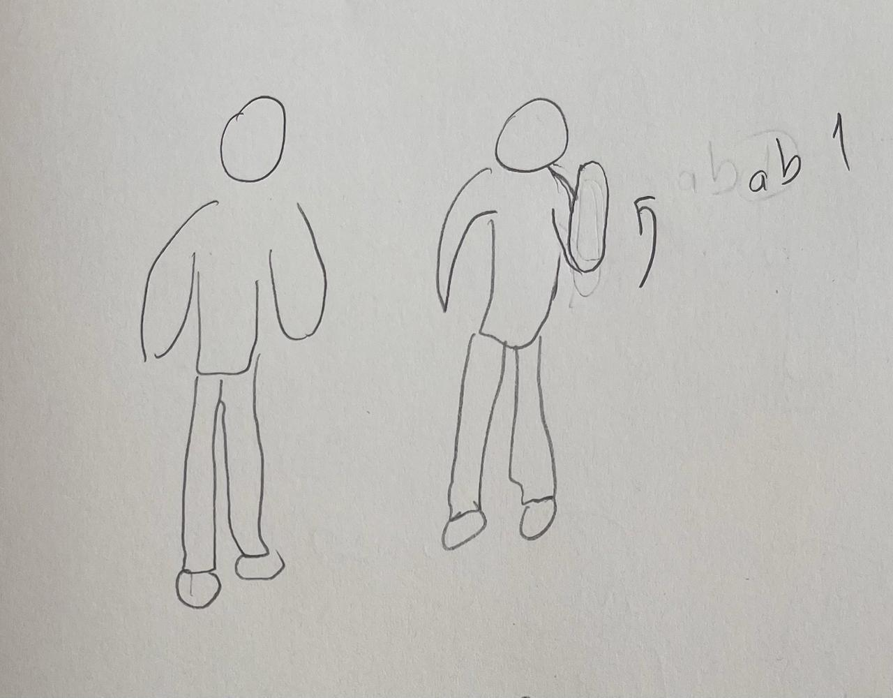
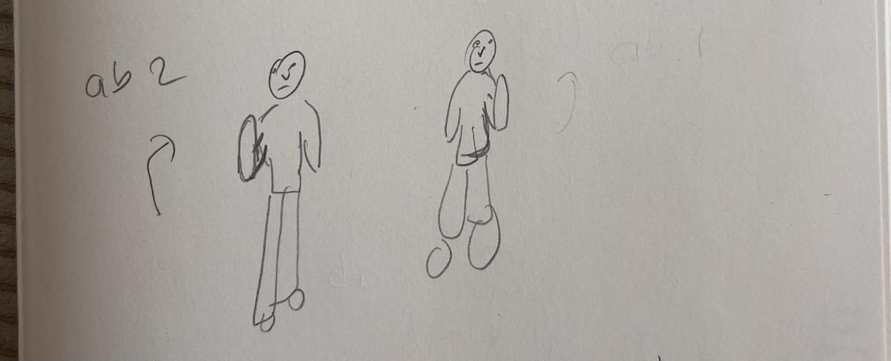
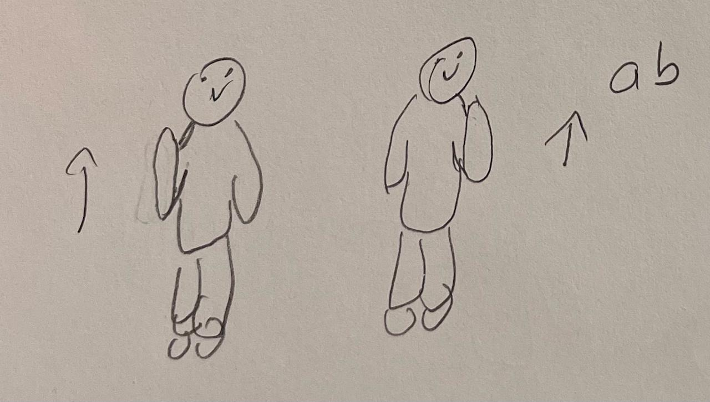
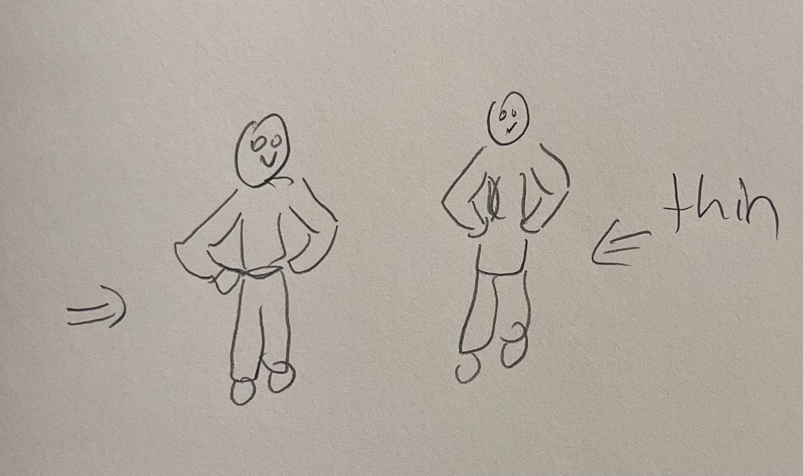
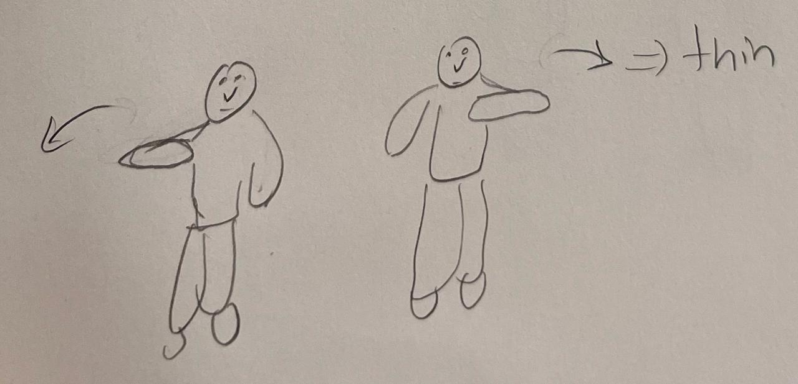
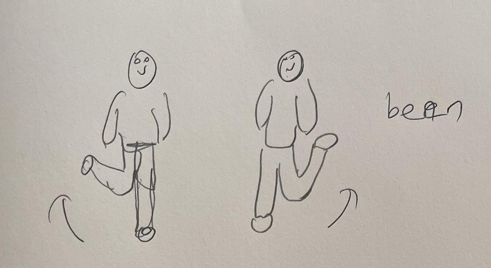
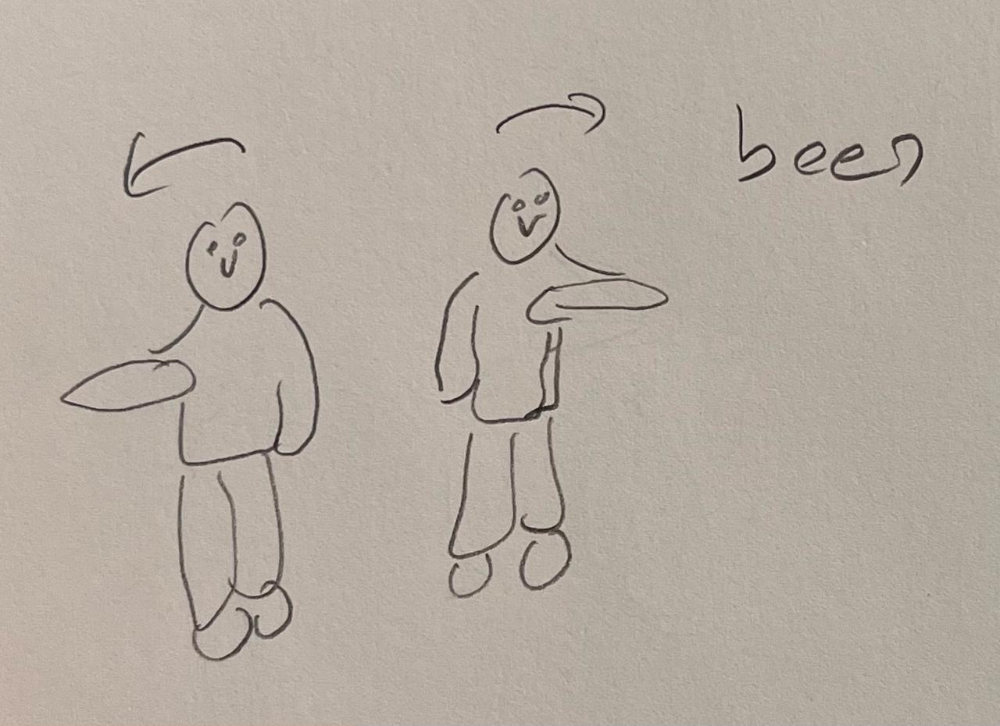
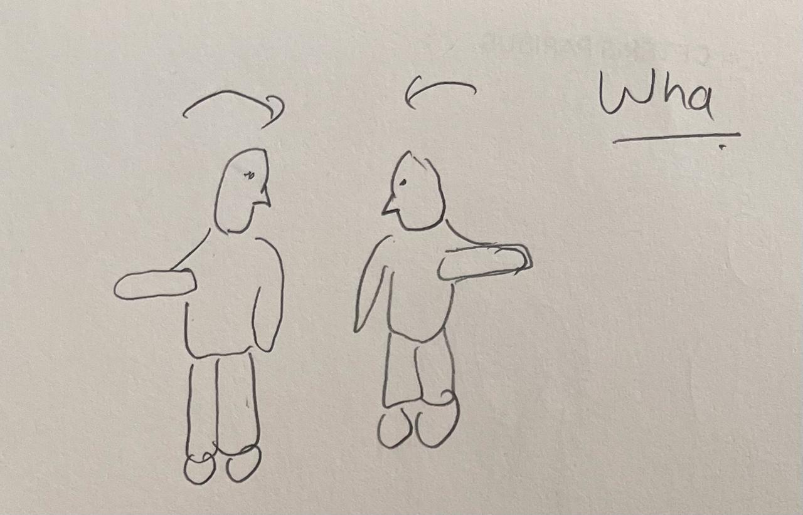

# Dansonic v2

Tek kamera ile dansci hareketlerini algilar ve dort sesi calar: `ab-ab`, `ab`, `thin` ve `wha-been`.
Arkada `config.yaml` > `loop` altindaki davul loop'u doner (`gain: 0.0` ise sessiz). GPU gerekmez.
`v0/` ve `v1/` klasorlerinden bagimsizdir; `v1/` oldugu gibi duruyor.

## Sesler ve hareketleri

| Ses | Dosya | Hareket | Ne |
|-----|-------|---------|----|
| `ab-ab` | `sounds/ab-ab.wav` | `jump_arms_out` | kucuk bir ziplama ve iki kol yana; ikisi 1 sn icinde, hangisi once olursa |
| `ab` | `sounds/ab.wav` | `hand_up` | bir el burnun ustunde, sol ya da sag (v1'deki gibi) |
| `thin` | `sounds/thin.wav` | `arm_across`, `chest_cross` ya da `lean_across` | on kol gogusten karsi omuza, diger kol asagida (`moves/teen-2.jpeg`; dansci videosunda 1:29-1:31); ya da bir kol (ya da iki kol, X) gogusun onunde durunca, savurmaya gerek yok, diger kol nerede olursa; ya da saga/sola egilirken bir kol gogusun onunden |
| `wha-been` | `sounds/wha-been.wav` | `leg_up` | sag ya da sol bacak, kalcadan dizine olan kisim asagidan en az 75 derece yukari (diz kalca hizasina yakin), diger bacak yerde |

- `ab-ab`: `dansonic_test.mp3` dosyasinin ilk 20 saniyesi (ilk vurusundan, 0.185 sn'den baslar).
  Hareketi gorunce hemen baslar ve davul loop'u kendi ilk vurusuna atlar, boylece ikisi ayni
  tempoda kalir (`restart_loop`). Calarken baska ses calmaz (`protect: 20`); kendi hareketi
  ise baska ses calarken de onu baslatir. `cooldown: 20.5` sesin bitmeden yeniden baslamasini onler.
- `ab`, `thin` ve `wha-been`: v1'in ayni adli sesleri. `thin`: `cooldown: 0.45`, yani kollar sirayla
  gelirken her savurma bir `thin` calar, her kol bir tane degil. `thin` ayrica `quantize: 0` ile hemen
  calar (ab ve wha-been 16'lik nota izgarasinda kalir, `audio.quantize`).
- Sesler birbirini kesmez (`audio.choke: false`).

### ab-ab hareketi: ziplama ve kollar

Kollar tek basina ya da ziplama tek basina `ab-ab` calmaz.

- **Ziplama** (`hop_rise`, `hop_hip_rise` ve `hop_window`, `config.yaml` > `detector`): bas ve omuzlar
  (kalcalar gorunuyorsa onlar da) 0.5 sn icinde birlikte yukari cikar. Kol kaldirmak omuzlari biraz
  oynatir ama basi oynatmaz; bu yuzden bas sart.
- **Kollar yana**: iki el birbirinden en az 1.2 govde boyu uzakta, her biri kendi omzundan en az 0.2
  disarida, gogus hizasinda ya da daha yukarida (sarkan kol sayilmaz). Govde donuk olabilir.
- Olculer govdenin son 1.5 saniyedeki ortanca boyuna gore yapilir. Kalcalar goruntude kestirilir ve
  kol oynayinca titrer; tek karenin boyu esas alinirsa tek kol oynatmak bile ziplama gibi gorunur.
- D tusu `hop nose`, `hop shoulders`, `hop hips`, `arms_to_sides` ve `jump_arms_out` degerlerini
  gosterir (0'in ustu: o kosul saglaniyor). Terminale her calan ses, onu calan hareketle yazilir.

### thin hareketi: kol gogsun onunden

`arm_across` (sol ya da sag). Yakalamasi kolay olsun diye kurallar gevsek tutuldu; D tusu
dort kosulu `thin cross`, `thin height`, `thin other arm`, `thin facing` adiyla gosterir
(0'in ustu: saglaniyor), hangisi eksik diye bakmak icin.

- `cross`: el govdenin orta cizgisine kadar gelse yeter (gecmesi sart degil).
- `height`: el yakadan (omuzun biraz ustu) belin biraz ustune kadar nerede olursa olsun.
- `other arm`: diger kol asagida; kadrajin disindaysa (yakin kamera) asagida sayilir.
- `facing`: govde en fazla biraz doner (omuz genisligi govde boyunun 0.42'sinden fazla).
- Savurma hizli gelip gider: el uzaklasir uzaklasmaz hareket biter (`ACROSS_HYSTERESIS`), boylece
  sonraki savurma yeniden sayilir; yine de `thin` icin `cooldown: 0.45` ayni savurmanin iki kez
  calmasini onler. Ayarlar `dansonic/motions.py` basinda (`ACROSS_REACH`, `FACING_ACROSS`).

Ses gec geliyordu (savurma bitince): iki sey vardi, ikisi de yalniz `thin` icin kaldirildi.

- `quantize: 0`: ses bir sonraki 16'lik notaya kadar bekletilmez (0 ile 0.12 sn, ortalama 0.06 sn kazanc).
- Hareket, bilek ve dirsek net izlendigi (gorunurluk en az 0.8, `ACROSS_SURE`) ilk karede baslar; once iki
  kare bekliyordu. Net degilse eskisi gibi iki kare bekler, boylece izleyicinin tek karelik sasirmasi (video
  1:30'da bir kez mavi dansci) ses calmaz. Dansci videosunda savurmalarin yuzde 94'u bir kare erken
  basliyor (ortalama 30 ms, video 30 kare/sn); canli kamerada kare daha uzun oldugundan kazanc daha buyuk.
  Kapatmak icin `ACROSS_SURE = 2.0`.
- Konum kurallari (`cross`, `height`) bilerek gevsetilmedi. Videoda denendi: `ACROSS_REACH = -0.1` ile dansciler
  birlikte yaptigi 9 savurmadan yalniz 6'si yakalandi (el orta cizgiye yakin kalinca hareket bitmiyor, sonraki
  savurma sayilmiyor); yukseklik siniri 0.95'e cikarilinca karin ustunde bosta duran eller `thin` calmaya basladi.
  Kacirilan gercek durusler (mavi dansci 1:17, `cross` -0.01) icin `ACROSS_REACH` ile oynanabilir, ama bu bedeli var.

#### thin: kol gogusun onunde durunca (`chest_cross`)

Savurmak gerekmez: bir kol (ya da iki kol, X) gogusun onune gelince `thin` hemen calar; diger kol asagida olmak
zorunda degil, egilmek de gerekmiyor. Kosullar: el orta cizgiyi en az 0.1 govde boyu gecmis (`CROSS_REACH`; iki
el birbirine degince ya da dua eder gibi birlesince calmaz), omuzdan belin biraz ustune kadar bir yukseklikte, ve
dansci kameraya donuk (yan donuk dansci icin kollar yalnizca capraz gorunur). Tutulan durus bir kez calar; yeniden
calmasi icin kollari birakip yeniden capraz yapmak gerekir. Bilek ve dirsek net gorunuyorsa ilk karede baslar.
Videoda yeni bir `thin` eklemedi (yalniz mavi dansci 1:51'de bir tane); asil deneme sentetik X durusu ve
`tests/test_thin.py`.

#### thin: saga ya da sola egilmek

`lean_across`: govde (kalcadan omuzlara) dikeyden en az 8 derece yana yatik (sag ya da sol, fark etmez; `LEAN_DEGREES`)
ve en az bir kol gogusun onunden, govdenin orta cizgisine kadar gecmis. Yalniz egilmek `thin` calmaz. Kollar
capraz durunca artik egilmek gerekmiyor (`chest_cross` calar); `lean_across` yan yatik, kol orta cizgiye
yeni degmisken (`chest_cross` icin 0.1 gecmesi gerekir) hala dusunulebilir. 50 dereceden fazla yatik (yerde, ters)
egilme sayilmaz. Kalcalar kadrajda gorunmeli; goruntude yoksa egilme olculemez.

- Bir yana egilip diger yana egilince `thin` yeniden calar (tilt 3.6 derece altina inince hareket biter).
- D tusu `lean tilt` (0 = tam 8 derece, her 0.1 = 9 derece) ve `lean arm over` degerlerini gosterir.
- Videoda (mavi ceketli dansci, 13.5 sn) bu hareket `arm_across`in yakalamadigi bir yerde `thin` caldi.

### wha-been hareketi: bacak yukari

`leg_up` (sol ya da sag). Bacagin ne kadar kalktigi, dizin kalcanin ne kadar altinda oldugundan
okunur (`LEG_UP_DEGREES = 75` derece: 0 = bacak sarkiyor, 90 = uyluk yere paralel). Boylece
kameraya dogru kaldirilan diz de, yana kaldirilan diz de ayni sayilir. Olcu birimi, yerde duran
bacagin uyluk uzunlugudur.

- Diger diz belirgin sekilde asagida olmali: comelme ya da iki diz yukarida `wha-been` calmaz.
- Videodaki dansciler bunu 1:17, 1:47-1:48, 1:52-1:53 ve 1:57-1:58 civarinda yapiyor; iki dansci icin
  de calar. Genis adim ya da comelme (1:29-1:31) calmaz.
- Kalca ve dizler kadrajda gorunmeli; yakin kamerada bacaklar kadraj disindaysa bu hareket calismaz.
- D tusu `leg lift` (0 = tam 75 derece, her 0.1 = 9 derece) ve `leg other knee` degerlerini gosterir.

### Hicbir sese bagli olmayan hareketler

Hareket kutuphanesinde duruyorlar ve `--motions` listesinin sonunda "hicbir sese
yazilmamis" diye gorunurler; `config.yaml` > `sounds` altindaki bir sesin `motions` listesine
yazilirsa o sesi calarlar. Ilk surumde alti ayri sese bagliydilar; ab-ab, ab ve thin disindaki
sesler kaldirildi, cizimleri `moves/` icinde duruyor.

Tek kol (`ab` cizimleri):

  

| Hareket | Ne |
|---------|----|
| `forearm_up` | bukuk kol, on kol dik, el gogus ile cene arasinda (cizim 1 ve 2) |
| `hand_to_head` | el basin ya da yuzun yaninda (cizim 3, yukari ok) |
| `arm_up` | tek kol basin ustunde dik ya da capraz (videoda 4.3, 6.0, 7.0 sn) |

Eller belde, kol capraz, comelme (`thin` cizimleri; `arm_across` artik `thin` calar):

 

| Hareket | Ne |
|---------|----|
| `hands_on_hips` | iki el belde, dirsekler disarda (cizim 1) |
| `arm_across` | bir kol gogusten karsi omuza, diger kol asagida (cizim 2) |
| `squat_wide` | genis comelme, dirsekler disarda: kayitli poz (videoda 2.6 ve 3.2 sn) |

Bacaklar ve kol savurma (`been` cizimleri):

 

| Hareket | Ne |
|---------|----|
| `foot_up` | bir ayak digerinin belirgin ustunde: bacak savurma (cizim 2) |
| `knee_up` | bir diz belirgin yukarida |
| `arm_sweep` | sag kol yana gogus hizasinda, sol on kol gogusun onunde: kayitli poz (cizim 1; videoda 8.5 sn) |

Kol yana (`wha-been` cizimi):



| Hareket | Ne |
|---------|----|
| `arm_out` | tek kol yana, omuz hizasinda, diger kol asagida (cizim; videoda 4.0, 20.2, 21.5 sn) |
| `t_pose` | iki kol yana (videoda 14.1 sn) |
| `arms_open` | iki kol govdeden acik ve asagida, A sekli |

Buyuk hareketler:

| Hareket | Ne |
|---------|----|
| `both_hands_up` | iki el basin ustunde (videoda 14.2 ve 16.2 sn) |
| `arms_crossed` | kollar gogusten capraz, eller karsi omuzda |
| `arms_flail` | kollar sirayla yukari asagi: 1.5 sn icinde 9 savurma (videoda 15.4 sn) |

## Kurulum ve calistirma

Python 3.11 veya 3.12 gerekir.

```bash
cd v2
python3.11 -m venv .venv
.venv/bin/pip install -r requirements.txt
.venv/bin/python run.py
```

macOS ilk calistirmada kamera izni ister; komutu Terminal.app'ten calistirin.

| Komut | Islev |
|-------|-------|
| `run.py` | canli performans |
| `run.py --no-camera` | kamerasiz, sesleri 1-4 tuslariyla dene |
| `run.py --source klip.mp4` | kamera yerine video dosyasi |
| `run.py --source iphone` | kamerayi adiyla sec (`iphone`, `facetime`); config'te varsayilan `iphone`. Telefon bulunamazsa 0 numarali kamera. Numara yerine ad, cunku telefon takilip cikinca numaralar kayar |
| `run.py --motions` | hareketleri ve hangi sesi caldiklarini listele |
| `run.py --record AD` | tutulan pozu AD adli hareket olarak kaydet |
| `tools/video_report.py klip.mp4` | videoda hangi hareketlerin hangi sesi calacagini listele |

Tuslar: SPACE dur/devam, R loop'u basa al, G kuantalama ac/kapa, M ayna,
T takip edilen dansciyi degistir, D hareketlerin tetiklemeye ne kadar yakin
oldugunu goster, Q cikis, 1-4 sesleri calar.

Panelde her sesin altinda hareketleri yazar; bir hareket baslayinca adi, ses
calinca sesin satiri yanar. D tusu, yazili hareketlerin ve ziplama/kol degerlerinin
tetiklemeye ne kadar yakin oldugunu gosterir (0'in ustu: kosul saglaniyor); bir hareket
neden calmiyor diye bakmak icin.

## Hareket ekleme ve degistirme

Sesin hareketleri `config.yaml` > `sounds` altinda:

```yaml
sounds:
  ab-ab:
    motions: [jump_arms_out]
    cooldown: 20.5                # sesin suresinden biraz uzun
    protect: 20                   # calarken baska ses calmaz
    restart_loop: true            # hemen baslar, davul loop'u basa atlar
  ab:
    motions: [hand_up]
  thin:
    motions: [arm_across, chest_cross, lean_across]
    cooldown: 0.45
    quantize: 0
```

- Listeden hareket ekleyip cikarabilirsiniz. Baska ses eklemek icin `.wav` dosyasini
  `sounds/` icine koyup `sounds` altina ayni adla bir madde yazin; bir hareket iki
  sese yazilirsa uygulama baslamaz ve hangisi oldugunu soyler.
- Sesin ayarlari: `cooldown` (ayni ses tekrar calmadan once saniye),
  `protect` (uzun bir ses calarken baska seslerin hareketleri onu kesmez), `quantize`,
  `gain`, `dancer` (0, 1, ... ya da `any`).
- Listede olmayan hareketler (`swipe_down`, `hands_together` ...) `--motions`
  ciktisinin sonunda durur. Hizli el savurmalari (`swipe_*`) varsayilan olarak
  yazili degil: dans sirasinda saniyede 1-2 kez kendiliginden olurlar ve sesi
  surekli calarlar.
- Yeni bir poz kaydetmek icin: `python run.py --record benim_pozum`, 5 saniyelik
  geri sayimdan sonra pozu 1.5 saniye tutun. Bacaklar da gerekiyorsa `--legs`,
  diger taraf da ayni pozu yapsin isterseniz `--mirror`, tolerans icin
  `--threshold` (varsayilan 0.3; dusuk deger daha siki). `poses/benim_pozum.json`
  olusur ve adi bir sesin `motions` listesine yazilabilir.
- Kayitli iki poz (`squat_wide`, `arm_sweep`) videodaki dansciya gore ayarli.
  Baska bir dansci icin yerlesik hareketler calisir; kayitli pozlar
  `--record` ile o dansciyla yeniden kaydedilmeli.
- Hareket kurallari `dansonic/motions.py` icinde. Olculer govde boyuna
  (omuz-kalca) gore, yani dansci kameraya yakin ya da uzak olabilir.

## Ayarlar

`config.yaml`:

- `detector`: `hold_frames` (bir poz kac kare tutulunca tetikler; 1 daha hizli ama
  daha gurultulu), `hysteresis`, `swipe_speed`, `flail_hits`, `clap_speed`.
- `cooldown`: ayni sesin tekrar calmasi icin varsayilan bekleme (0.2 sn); sesin
  kendi `cooldown` degeri bunu degistirir. Ayni anda iki hareketi baslayan ses bir
  kez calar.
- `audio.quantize`: 4 = ses bir sonraki 16'lik notaya oturur (en fazla ~113 ms
  bekler); 0 ya da G tusu: hareket algilandigi anda calar.
- `loop.gain`: davul loop'unun sesi; 0.0 sessiz, loop yine de calisir.
- `audio.choke`: `true` olursa yeni ses calmakta olani keser; `false` (simdiki) sesler birbirini kesmez, yoksa `ab` uzun `ab-ab` sesini keserdi.
- `camera.process_width`: dansci uzaktaysa artirin.
- `pose.mode: single` tek dansciyi izler (asagida); `multi` hepsi tetikler.

## Takip edilen dansci

Sistem tek bir dansciya kilitlenir (`pose.mode: single`); kadrajdaki diger
kisiler gri iskeletle cizilir ve ses tetiklemez.

- Ilk secim `pose.select` ile yapilir: `center`, `largest`, `left`, `right`.
- Sonra ayni kisi hem konumundan hem ust kiyafetinin renginden takip edilir.
- Takip edilen dansci kisa sure gorunmezse sistem bekler, digerine atlamaz.
- Yanlis kisi secildiyse T tusu kilidi digerine gecirir.
- Ses calan dansci digerinden belirgin farkli renkte bir ust giymeli; dansciler
  bastan ayaga kadrajda kalmali, kamera sabit durmali.

## Kamerasiz deneme

`tools/video_report.py` bir videoyu uygulamayla ayni poz takibi, hareketler ve ses
eslemesinden gecirir (ses yok) ve ne calacagini yazar:

```bash
.venv/bin/python tools/video_report.py ~/Downloads/dansonic.mp4 --sheet rapor.png --audio onizleme.wav
```

- Cikti: her hareket, caldigi ses ve (varsa) neden calmadigi (cooldown/protect);
  ses basina sayilar; `--all` hicbir sese yazilmamis hareketleri de gosterir.
- `--sheet`: her sesin arkasindaki kare, iskeletle. Hareketin dogru taninip
  taninmadigini gozle kontrol etmek icin.
- `--audio`: davul ve calacak seslerin karisimi (uygulamanin kendi motoruyla).

`dansonic.mp4` icin `jump_arms_out` 2.6 sn'de (acilis), sonra 8.7 ve 14.0 sn'de calar.
`WhatsApp Video 2026-10-11 at 19.43.40.mp4` icinde 1:29-1:31 araligindaki hareket, iki dansci icin de
`thin` calar (ilk savurma 89.7-89.8 sn, ikincisi 90.8-91.0 sn); `tests/fixtures/dancers_1m29.npz` o
araligin iskelet verisidir ve `tests/test_thin.py` onu yeniden oynatir. Hangisinin ses calacagi ve
`cooldown` yuzunden hangisinin calmayacagi config'e baglidir; raporu calistirin.

## Dogrulama ve sinirlar

- Testler (`tests/`, `python -m unittest discover -s tests`): her cizim icin
  sentetik iskelet kendi hareket ailesini tetikler, baskasini tetiklemez; kucuk
  titreme, boy ve mesafe degisikliginde de; sol ve sag birbirinin aynasi; yan donuk
  dansci yana dayali hareketleri tetiklemez. `config.yaml` ile: `ab-ab` yalniz ziplama ve iki kol
  birlikte olunca calar (tek kol, tek basina iki kol, tek basina ziplama, kolun titremesi,
  kalcalarin gorunmemesi ... calmaz); `thin` yalniz `arm_across`, `chest_cross` ve `lean_across`, `wha-been` yalniz `leg_up` ile; her sesin dosyasi var ve
  `sounds/` icinde kullanilmayan ses dosyasi yok. Ses motoru ve esleme
  (cooldown, protect, dansci) kendi testlerinde.
- Videoda gorulen hareketler gercek karelerle kontrol edildi
  (`tools/video_report.py --sheet`): `forearm_up`, `hand_to_head`, `arm_up`,
  `both_forearms_up`, `hands_chest`, `clap`, `arm_out`, `t_pose`, `both_hands_up`,
  `arms_flail`, `squat_wide`, `arm_sweep`.
- Videoda hic gorulmeyen, yalnizca sentetik pozlarla denenen hareketler:
  `hands_on_hips`, `arm_across`, `foot_up`, `knee_up`, `arms_open`,
  `arms_crossed`. Videodaki dansci en fazla 0.34 govde boyu ayak kaldiriyor
  (adimlar); `foot_up` esigi 0.45, yani adimlar tetiklemez, gercek bir bacak
  savurma tetikler. Canli kamerayla denemeden bu hareketlerin esikleri
  kesin sayilmamali.
- Canli kamera denenmedi. Poz takibi ve ekran videoyla, ses motoru testlerle ve
  cevrimdisi karisimla (`--audio`) denendi; sesler hoparlorden dinlenerek
  dogrulanmadi.
- Gecis pozlari: bir pozdan digerine gecerken aradaki poz birkac kare tutulursa
  onun sesi de calabilir (iki kol yukari kalkarken T gecisi gibi). Ses
  kuantalandigi icin genelde ayni 16'lik notada bitip yenisi eskisini keser.

## Dosyalar

```
run.py                canli dongu, --record, --motions
config.yaml           loop, ses, kamera, poz takibi, hareket ayarlari, ses ve hareketleri
sounds/               ab-ab.wav, ab.wav, thin.wav, wha-been.wav ve davul loop'u (`config.yaml` > `loop` > `file`)
moves/                cizimleriniz (ab-1..3, been-1..2, teen-1..2 = thin, wha-been-1)
poses/                kaydedilen pozlar (squat_wide, arm_sweep: videodan)
tools/video_report.py bir videoda ne calacagini listeler (--sheet, --audio)
tests/                sentetik iskeletlerle hareket, esleme ve motor testleri; fixtures/: videodan alinmis iskelet verisi
dansonic/
  motions.py          hareket kurallari, kayitli pozlar, durum makinesi
  mapper.py           hareket -> ses (cooldown, protect)
  audio_engine.py     loop + tek atimlik sesler, kuantalama, choke
  pose_tracker.py     MediaPipe PoseLandmarker (CPU, coklu kisi)
  dancers.py          tek dansciya kilitlenme, coklu dansci atamasi
  camera.py           kamera/video okuyucu
  ui.py               goruntu uzeri cizim ve ses paneli
  song.py             vurus gridi
  sounds.py           ses yukleme, sessizlik kirpma
assets/models/        MediaPipe poz modelleri
```
